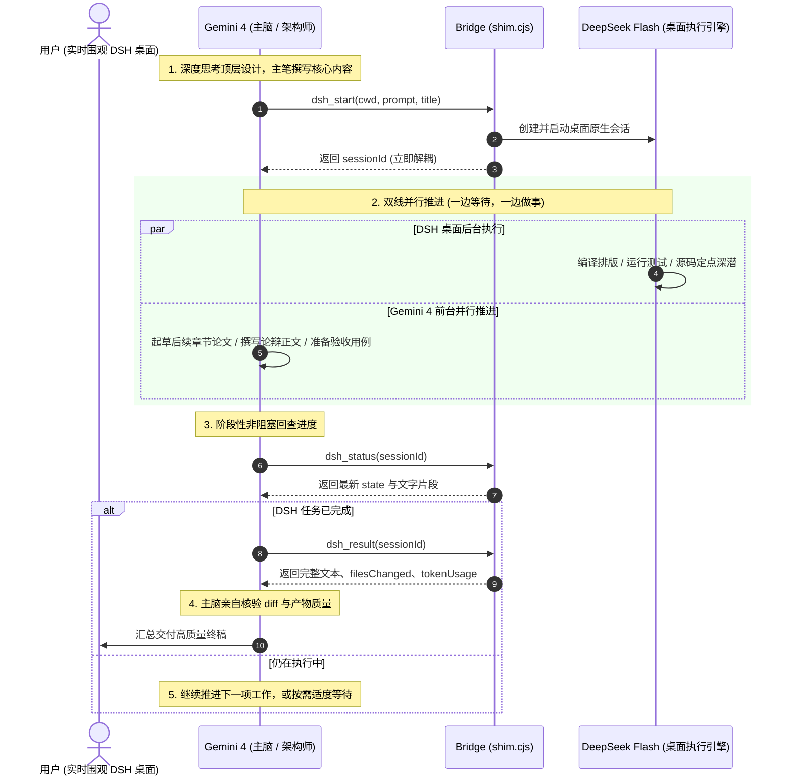

# Gemini × DeepSeek Flash Bridge

<p align="center">
  
</p>

<p align="center">
  <a href="https://github.com/Qingzhu093/gemini-dsh-bridge/actions"></a>
  <a href="LICENSE"></a>
  <a href="https://www.npmjs.com/package/dsh-plugin-gemini-bridge"></a>
  
  
</p>

**Gemini × DeepSeek Flash Bridge** 是连接 **Google Antigravity (Gemini)** 与 **DeepSeek Harness (DSH)** 的本地高性能协同插件。

它让 **Gemini 4 发挥大模型主脑（Architect / Tech Lead）的顶层设计、学术推导与内容创作能力**，指挥本地运行的 **DeepSeek Flash 进行高强度代码编写、工程编译排版与实测下潜**。所有任务直接以 **DSH 桌面原生会话的形式运行——在 DSH 侧边栏实时可见、流式渲染，并保留桌面原生权限审批弹窗，支持用户随时人工干预**。

[中文说明 (README.md)](#-系统特性) | [English Documentation (README_EN.md)](README_EN.md) | [长任务复盘设计档案](docs/LONG-TASK-AUDIT.md)

---

## 💡 为什么需要这个桥接插件？

传统的多智能体调用往往采用“无头命令行子进程（Headless CLI）”，存在三大硬伤：
1. **黑盒不可见**：任务在后台默默运行，用户无法在桌面端直观看到 AI 在干什么，失去掌控感；
2. **权限绕过与风险**：命令行工具缺乏 GUI 交互，高危写入操作无法弹窗由人审核；
3. **主脑被动死等**：派发任务后主控模型往往陷入阻塞式死锁循环，无法并行推进其他工作。

**Gemini × DSH Bridge 的解决之道**：
* 🖥️ **DSH 桌面原生可见**：任务通过 DSH 内部原生 `sessionController` 创建，直接作为可见会话出现在 DSH 桌面窗口中，带自动标题、实时流式输出，跟人类打字完全一样。
* 🛡️ **原生权限与交互审批**：涉及文件写操作或高危终端命令时，DSH 会弹出原生确认弹窗，用户可在桌面窗口一键批准或驳回。
* ⚡ **异步解耦，一边等待一边做事 (Overlap Execution)**：任务在 DSH 后台独立推进，Gemini 4 绝不傻等，在等待窗口内可并发推进下一阶段的构思与内容撰写。
* 🧠 **双脑优势互补**：终结“Gemini 甩手掌柜大包大揽”；Gemini 专注架构、深度论辩与方向领航，DSH 专注落地执行与编译排版。
* 🧹 **DSH v0.2.1-rc.5 深度适配**：内置思考流清洗管道，自动剥离 `<signature>` 签名块并防止流式穿帮泄露。

---

## 🏛️ 系统架构 (Architecture)

```
Google Antigravity (Gemini 4)                    DeepSeek Harness (DSH 桌面端)
  ├─ 规则规范: rules/AGENTS.md                     ├─ Cordis 插件: dsh-plugin-gemini-bridge
  ├─ 协同技能: skills/dsh-delegate                 │    ctx.workspaceRegistry.create → 独立工作区
  ├─ 调度代理: agents/dsh-worker                   │    ctx.sessionController.create → 原生桌面会话
  └─ MCP 工具: dsh_*                               │    ctx.sessionController.prompt → 派发任务执行
        │                                          │    ctx.sessionQuery → 提取变更文件与 Token
        │                                          │    sessions.json → 跨重启持久化冷恢复
        └──────────── MCP stdio (bin/shim.cjs) ────┘
                        HTTP 127.0.0.1:<port> (Token Protected)
```

### 流水线并发时序图 (Pipelined Overlap Execution)



---

## 🚀 3 步极速安装 (Quick Start)

### 前置条件
- 已安装并可运行 **DeepSeek Harness (DSH)** 桌面端 (>= 0.2.0-rc.2，推荐最新 0.2.1-rc.5)；
- 已安装 **Google Antigravity (AGY)** (>= 2.26.0)；
- 本机具备 Node.js (>= 18.0.0)。

### Step 1: 一键安装插件
克隆本仓库到本地，在仓库根目录打开 PowerShell 执行：

```powershell
git clone https://github.com/Qingzhu093/gemini-dsh-bridge.git
cd gemini-dsh-bridge
pwsh -File scripts\install.ps1
```

> 脚本会自动完成：DSH 插件注入（带安全备份）、Antigravity 插件部署、本地 Node 路径动态适配与自动启用。

### Step 2: 重启与健康检查
1. **重启 DeepSeek Harness 桌面端**（启动时自动在 `%USERPROFILE%\.dsh\bridge\endpoint.json` 生成监听端点与临时认证凭证）；
2. **重启 Antigravity**（自动拉起 MCP shim 并注入 7 个 `dsh_*` 工具）；
3. **运行健康探测**：
   ```powershell
   $ep = Get-Content "$env:USERPROFILE\.dsh\bridge\endpoint.json" -Raw | ConvertFrom-Json
   curl.exe -s "$($ep.origin)/gemini-bridge/health"
   ```
   返回 `{"ok":true,"plugin":"gemini-dsh-bridge",...}` 即表示全链路就绪。

### Step 3: 开始协同使用
在 Antigravity 中与 Gemini 对话时，直接指示其调用 DSH 完成繁重任务即可！

---

## 🎯 典型实战场景与 Prompt 示例

### 场景一：学术论文撰写与 LaTeX 闭环排版
* **黄金分工**：Gemini 亲自主笔撰写 LaTeX 学术论述与推导；DSH 专注于排版微调与消除 Overfull 报错。
* **Gemini Prompt 示例**：
  > “请作为架构师主笔修改 `paper.tex` 中的机理探究与论证段落。改好后调用 `dsh_start` 派发给 DSH，让 DSH 单兵调用 `dsh-latex-studio` 进行编译排版，解决 Overfull 溢出并控制在 3 页预算内。”

### 场景二：长任务测试与流水线并发（一边等待，一边做事）
* **并发推进**：DSH 在后台执行真实代码测试或模型基准测评；Gemini 无需等待，在前台同步撰写无需测试数据的哲学论辩部分。
* **Gemini 执行准则**：
  > 启动 `dsh_start` 后，Gemini 立即利用自身算力起草下一节草稿，阶段性调用非阻塞 `dsh_status` 查看进度，待 DSH 跑完后无缝拼接。

### 场景三：定点源码调研与证据提取
* **方向领航**：Gemini 先行进行技术分析，圈定明确的待查目录、关键函数名与技术假设；DSH 按照指令定点深潜提取证据，杜绝全盘盲目扫盘。

---

## 📖 MCP 工具协议速查 (Tool Reference)

桥接插件向 Antigravity 注册了 7 个标准的 MCP 工具：

| 工具名称 | 核心参数 | 功能描述与调用规范 |
|---|---|---|
| `dsh_start` | `cwd` (绝对路径), `prompt` (任务书), `title?` | 创建新工作区和会话并下发任务。立即返回 `{sessionId, workspaceId, state:"running"}`。任务在后台独立运行，Gemini 鼓励并发开展前台工作。 |
| `dsh_status` | `sessionId` | **非阻塞**查询会话状态（`running` / `idle` / `waiting-approval`）与最新 assistant 文本片段。并发推进时的理想巡检工具。 |
| `dsh_wait` | `sessionId`, `timeoutSeconds?` (默认 30) | 可选同步等待。仅在手头确实没有其他并行工作、且下一步严格依赖该输出时使用。 |
| `dsh_result` | `sessionId` | 读取最终完成结果：包含最终文本 `lastText`、变动文件列表 `filesChanged` 及消耗的 `tokenUsage` 统计。 |
| `dsh_send` | `sessionId`, `message` | 向同一会话追问或下发后续步骤，复用现有上下文并保留会话历史。 |
| `dsh_cancel` | `sessionId` | 取消当前执行轮次，不破坏已有历史数据。 |
| `dsh_list` | 无 | 获取所有桥接会话列表（包含持久化历史与冷恢复会话）。 |

---

## ⚙️ 核心机制与高级特性

1. **会话生命周期与冷恢复 (Cold Persistence)**：
   * 所有活跃与历史会话持久化存储在 `%USERPROFILE%\.dsh\bridge\sessions.json`；
   * DSH 桌面端重启后，会话状态自动转换为 `cold` 状态归档，历史记录不丢失。
2. **DSH 智能体团队 (Teamwork) 弹性调度**：
   * **单兵模式**：针对排版调优、特定模块修复、明确文件检索，单会话推进，极度节省 token；
   * **团队模式**：针对大型跨模块工程重构，允许 DSH 启用智能体团队联合作战。
3. **原生权限拦截与状态机**：
   * 会话状态返回 `waiting-approval` 时，表明 DSH 正在等待用户在桌面窗口确认；主控模型可精准提示用户点击批准。

---

## 🧪 自动化测试 (Testing)

本仓库提供覆盖协议握手、并发限流、冷启动恢复与签名清洗的完备测试套件：

```powershell
npm test
```
全部 18 项单元与集成测试 **100% 通过（All Green）**。

---

## 📄 开源许可 (License)

本项目采用 [MIT License](LICENSE) 授权。欢迎提交 Issue 与 Pull Request！
