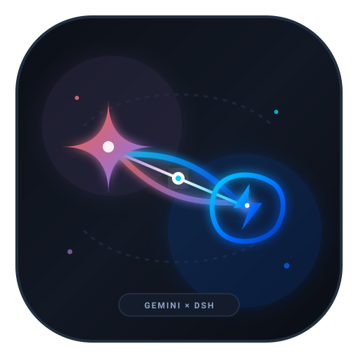
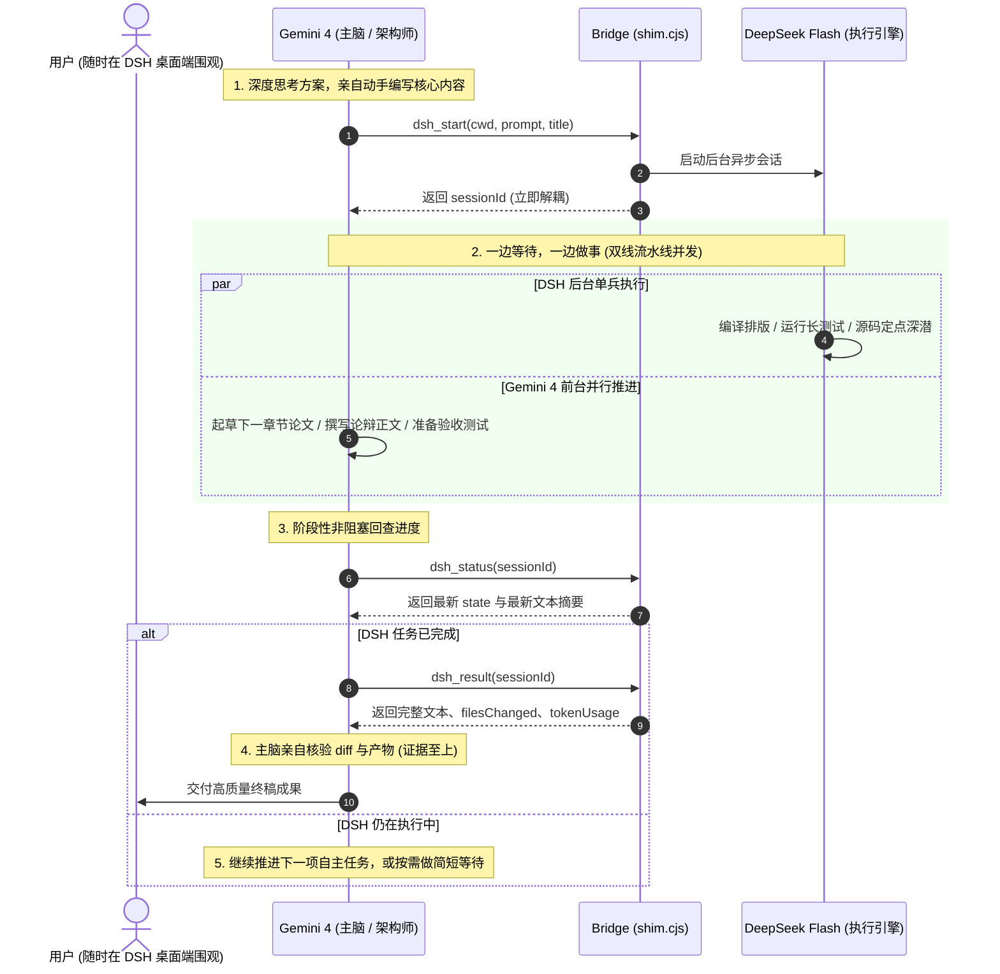

# Gemini × DeepSeek Flash Bridge (v0.3.2)

<p align="center">
  
</p>

<p align="center">
  <a href="#-中文使用说明"></a>
  <a href="LICENSE"></a>
  <a href="https://www.npmjs.com/package/dsh-plugin-gemini-bridge"></a>
  
  
</p>

连接 **Google Antigravity (Gemini)** 与 **DeepSeek Harness (DeepSeek Flash)** 的双向协同桥梁。让 Gemini 4 发挥大模型主脑（Architect / Tech Lead）的顶层思考与内容创作优势，指挥 DSH 进行高强度工程落地与编译排版；同时任务在 **DSH 桌面窗口中实时渲染、全程可见、支持用户随时干预**。

[中文文档 (README.md)](#-中文使用说明) | [English Documentation (README_EN.md)](README_EN.md)

---

## 🌟 v0.3.1 核心演进：全面适配 DSH v0.2.1-rc.5 与长任务解耦

### 1. 深度适配 DSH v0.2.1-rc.5 思考链清洗机制
- **签名/元数据块自动剥离**：引入对齐官方 `reasoning-text` 规范的 `cleanReasoningAndSignatures` 清洗管道，彻底剔除 `<signature>...</signature>` 元数据块。
- **流式防穿帮保护**：在模型流式思考尚未闭合 `<signature>` 标签时实施边界拦截，防止未闭合的标签与乱码数据泄露至 Gemini 回传文本。
- **纯净文本提取**：保证 Gemini 获取的 `lastText` 始终为纯净推理或代码正文，不受标签噪音干扰。

### 2. 双脑黄金分工矩阵 (Work Division Matrix)
拒绝 Gemini“甩手掌柜”或把事情一股脑抛给 DSH 大包大揽：
- **Gemini 4（大模型主脑 / 架构师）**：自主承担顶层逻辑解构、方案权衡；亲自主笔论文核心论点推导、哲学论辩与关键提示词；给出清晰明确的调研方向与技术假设。
- **DeepSeek Flash / DSH（执行引擎 / 资深工程师）**：专攻深水区代码重构、批量改写、LaTeX 编译排版（消除 Overfull、对齐 BibTeX、调整浮动体与页边距）、定点代码库深潜检索。

> **典型长任务范式（学术论文）**：Gemini 亲自主笔在上下文中打磨修改 LaTeX 核心学术文本，交由 DSH 专注于排版微调与自动化编译闭环，各展所长。

### 2. 异步解耦：“一边等待，一边做事” (Overlap Execution)
破除“调用 start 之后必须连续阻塞死等”的旧思维：
- 参考 **Antigravity Subagent / Task 机制** 与 **DSH 智能体团队 (Teamwork) 并发哲学**：DSH 会话在本地作为后台独立进程运行。
- **流水线并发范式**：Gemini 启动 DSH 后，**无需在原地阻塞死等**，可立即利用自身算力并发推进下一阶段工作（如起草后续章节草稿、构思反例、准备验收用例）；阶段完成后再通过非阻塞的 `dsh_status` 回查进展，实现双线并行。

### 3. 科学调度 DSH 智能体团队 (Teamwork)
- **单兵执行模式（常规明确任务首选）**：针对排版调优、特定模块修复、明确文件的检索，单会话推进，响应迅速且大幅节约 token 额度。
- **智能体团队模式（大型复杂工程选用）**：针对跨多个子系统的全栈脚手架重构、异构系统迁移，按需允许启用 DSH 团队协同，发挥多兵种优势。

---

## 🏛️ 系统架构 (Architecture)

```
Antigravity (Gemini 4 / 3.8 Flash)              DeepSeek Harness (DeepSeek Flash)
  ├─ 规则规范: rules/AGENTS.md                     ├─ Cordis 插件: dsh-plugin-gemini-bridge
  ├─ 技能指引: skills/dsh-delegate                 │    ctx.workspaceRegistry.create → 独立工作区
  ├─ 调度代理: agents/dsh-worker                   │    ctx.sessionController.create → 原生可见会话
  └─ MCP 工具: dsh_*                               │    ctx.sessionController.prompt → 派发任务
        │                                          │    ctx.sessionQuery → 提取变更文件与 Token
        │                                          │    sessions.json → 跨重启持久化存储
        └──────────── MCP stdio (bin/shim.cjs) ────┘
                        HTTP 127.0.0.1:<port> (Token Protected)
```



---

## 🛠️ 安装与快速上手 (Installation)

### 前置条件
- 已安装并运行 **DeepSeek Harness (DSH)** 桌面端 (>= 0.2.0-rc.2)。
- 已安装 **Google Antigravity (AGY)** (>= 2.26.0)。
- 本地具备 Node.js (>= 18.0.0)。

### 方式一：本地一键安装脚本 (推荐开发者)
在仓库根目录打开 PowerShell 执行：

```powershell
pwsh -File scripts\install.ps1
```

脚本将自动执行以下步骤：
1. 将 `dsh-plugin/` 安装至 `%USERPROFILE%\.dsh\plugins\gemini-dsh-bridge`；
2. 在 `%USERPROFILE%\.dsh\profiles\desktop\cordis.patch.yml` 中安全注入插件声明；
3. 将 `antigravity-plugin/` 安装至 `%USERPROFILE%\.gemini\config\plugins\gemini-dsh-bridge`；
4. 自动解析本机 Node.js 路径并写入 `mcp_config.json`，在 Antigravity 插件配置中完成启用。

### 方式二：通过 NPM 安装 DSH 端插件
```bash
npm install -g dsh-plugin-gemini-bridge
```

### 验证生效
1. **重启 DeepSeek Harness**（启动时自动在 `%USERPROFILE%\.dsh\bridge\endpoint.json` 生成监听端点与临时凭证）。
2. **重启 Antigravity**（自动加载 MCP shim 并注册 `dsh_*` 工具）。
3. **健康检查**：
   ```powershell
   $ep = Get-Content "$env:USERPROFILE\.dsh\bridge\endpoint.json" -Raw | ConvertFrom-Json
   curl.exe -s "$($ep.origin)/gemini-bridge/health"
   ```
   返回 `{"ok":true,"plugin":"gemini-dsh-bridge",...}` 即表示全链路就绪。

---

## 📖 MCP 工具协议合同 (Tool Specifications)

| 工具名称 | 核心参数 | 功能描述与调用建议 |
|---|---|---|
| `dsh_start` | `cwd` (绝对路径), `prompt` (任务书), `title?` | 启动 DSH 后台会话。立即返回 `sessionId`。任务进入后台独立执行，Gemini 鼓励并发开展自身工作。 |
| `dsh_status` | `sessionId` | **非阻塞**查询会话状态（`running`/`idle`/`waiting-approval`）与最新文字尾部。并发推进时的理想查询工具。 |
| `dsh_wait` | `sessionId`, `timeoutSeconds?` (默认 30, 最长 120) | 可选同步等待。仅在手头无其他并行任务、且必须依赖产物时使用。 |
| `dsh_result` | `sessionId` | 获取结构化执行结果：包含最终文本 `lastText`、修改的文件列表 `filesChanged` 及消耗的 `tokenUsage`。 |
| `dsh_send` | `sessionId`, `message` | 向同一会话追问或下发后续步骤，复用现有上下文并保留会话历史。 |
| `dsh_cancel` | `sessionId` | 取消当前执行轮次，不破坏已有历史数据。 |
| `dsh_list` | 无 | 获取所有桥接会话列表。 |

---

## 🧪 测试套件 (Unit Tests)

本仓库配备 17 项端到端及单元测试，覆盖 MCP 协议、握手、并发控制、断点恢复与状态机转移：

```powershell
npm test
```

---

## 📄 开源许可 (License)

本项目采用 [MIT License](LICENSE) 授权。欢迎提交 Issue 与 Pull Request！
