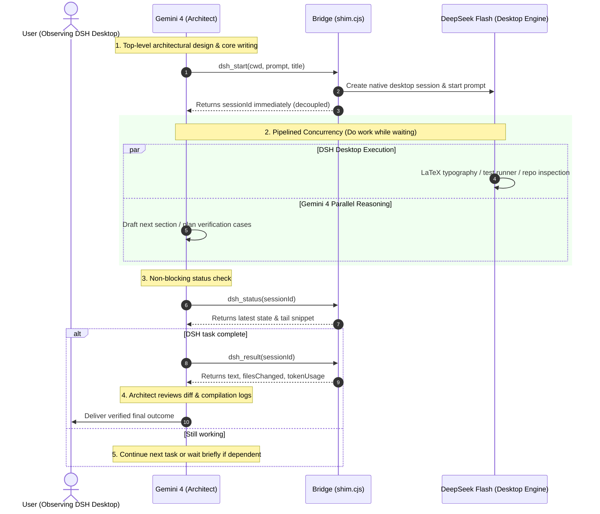

# Gemini × DeepSeek Flash Bridge

<p align="center">
  
</p>

<p align="center">
  <a href="https://github.com/Qingzhu093/gemini-dsh-bridge/actions"></a>
  <a href="LICENSE"></a>
  <a href="https://www.npmjs.com/package/dsh-plugin-gemini-bridge"></a>
  
  
</p>

A high-performance bridge connecting **Google Antigravity (Gemini)** and **DeepSeek Harness (DSH)**.

It empowers **Gemini 4 as the Architect / Tech Lead** (top-level system design, theoretical deduction, and core content creation), while orchestrating **DeepSeek Flash (running in DSH) for heavy-lifting code implementation, LaTeX compilation/typography, and empirical testing**. All delegated tasks run directly as **native DSH desktop sessions — streaming live in the sidebar with native permission modals for transparent human oversight**.

[中文文档 (README.md)](README.md) | [English Documentation (README_EN.md)](#-features) | [Long-Task Audit Notes](docs/LONG-TASK-AUDIT.md)

---

## 💡 Why This Bridge?

Traditional multi-agent systems often rely on "headless CLI subprocesses", which suffer from three critical flaws:
1. **Black-box opacity**: Tasks run hidden in the background without UI streaming, depriving developers of situational awareness.
2. **Security & Permission Bypass**: Headless tools cannot pop up interactive native confirmation windows for critical write operations.
3. **Blocking Wait Loops**: Dispatchers freeze in tight polling loops, wasting compute while waiting.

**How Gemini × DSH Bridge Solves This**:
* 🖥️ **Native Desktop Visibility**: Sessions are instantiated via DSH's native `sessionController`, appearing in the desktop sidebar with automatic titles and streaming text, identical to human chats.
* 🛡️ **Interactive Security Modals**: Sensitive file writes and shell commands trigger DSH's native permission popups, allowing one-click approval or intervention.
* ⚡ **Overlap Execution (Do Work While Waiting)**: DSH executes asynchronously in the background. Gemini 4 never freezes in wait loops; it immediately drafts subsequent chapters or unit tests in parallel.
* 🧠 **Specialized Division of Labor**: Gemini focuses on high-level reasoning, critique, and direction; DSH handles implementation, compilation, and typography.
* 🧹 **DSH v0.2.1-rc.5 Clean-up**: Built-in reasoning cleaner automatically strips `<signature>` blocks and defends against in-flight stream leaks.

---

## 🏛️ Architecture

```
Google Antigravity (Gemini 4)                    DeepSeek Harness (DSH Desktop)
  ├─ Rules: rules/AGENTS.md                        ├─ Cordis Plugin: dsh-plugin-gemini-bridge
  ├─ Skills: skills/dsh-delegate                   │    ctx.workspaceRegistry.create → Isolated Workspace
  ├─ Agent: agents/dsh-worker                      │    ctx.sessionController.create → Native Desktop Session
  └─ MCP Tools: dsh_*                              │    ctx.sessionController.prompt → Dispatch Execution
        │                                          │    ctx.sessionQuery → Extract Files & Token Usage
        │                                          │    sessions.json → Cold Reboot Persistence
        └──────────── MCP stdio (bin/shim.cjs) ────┘
                        HTTP 127.0.0.1:<port> (Token Protected)
```

### Pipelined Overlap Execution Flow



---

## 🚀 Quick Start (3 Steps)

### Prerequisites
- **DeepSeek Harness (DSH)** Desktop (>= 0.2.0-rc.2, recommended v0.2.1-rc.5).
- **Google Antigravity (AGY)** (>= 2.26.0).
- Local Node.js runtime (>= 18.0.0).

### Step 1: Install with One-Click Script
Clone the repository and run in PowerShell:

```powershell
git clone https://github.com/Qingzhu093/gemini-dsh-bridge.git
cd gemini-dsh-bridge
pwsh -File scripts\install.ps1
```

> The script automatically installs the DSH Cordis plugin (with profile backup), deploys the Antigravity plugin, and adapts your local Node executable path.

### Step 2: Restart & Health Check
1. **Restart DeepSeek Harness Desktop** (generates runtime token and loopback endpoint in `%USERPROFILE%\.dsh\bridge\endpoint.json`);
2. **Restart Antigravity** (loads MCP shim and registers 7 `dsh_*` tools);
3. **Verify connectivity**:
   ```powershell
   $ep = Get-Content "$env:USERPROFILE\.dsh\bridge\endpoint.json" -Raw | ConvertFrom-Json
   curl.exe -s "$($ep.origin)/gemini-bridge/health"
   ```
   A JSON response with `{"ok":true,"plugin":"gemini-dsh-bridge",...}` confirms readiness.

### Step 3: Start Collaborating
In Antigravity chat, instruct Gemini 4 to delegate heavy execution tasks to DSH!

---

## 📖 MCP Tool Specifications

The bridge exposes 7 standard MCP tools:

| Tool | Parameters | Description |
|---|---|---|
| `dsh_start` | `cwd` (absolute), `prompt`, `title?` | Launches a native DSH desktop session. Returns `{sessionId, workspaceId, state:"running"}` immediately. Encourages Gemini to proceed with parallel work. |
| `dsh_status` | `sessionId` | **Non-blocking** query of session state and latest tail text. Ideal for progress checks during concurrent work. |
| `dsh_wait` | `sessionId`, `timeoutSeconds?` (default 30) | Optional synchronous wait. Use only when strictly dependent on output with no parallel tasks available. |
| `dsh_result` | `sessionId` | Retrieves final text, `filesChanged`, and `tokenUsage` statistics. |
| `dsh_send` | `sessionId`, `message` | Sends follow-up message to the existing session context without losing history. |
| `dsh_cancel` | `sessionId` | Cancels current execution turn safely without destroying history. |
| `dsh_list` | None | Lists all bridge sessions (including persisted cold sessions). |

---

## ⚙️ Advanced Features

1. **Cold Persistence**: All active and completed sessions are stored in `%USERPROFILE%\.dsh\bridge\sessions.json`. Sessions seamlessly transition to archived `cold` state across desktop restarts.
2. **Elastic Teamwork Orchestration**: Single-session mode for targeted edits (conserving tokens); Teamwork mode enabled on-demand for full-stack multi-module refactoring.
3. **Interactive Approval Handling**: When state becomes `waiting-approval`, the tool notifies the agent to prompt the user to click approve in the DSH desktop window.

---

## 🧪 Testing

```powershell
npm test
```
All 18 unit and integration tests **100% PASS (All Green)**.

---

## 📄 License

Distributed under the [MIT License](LICENSE).
