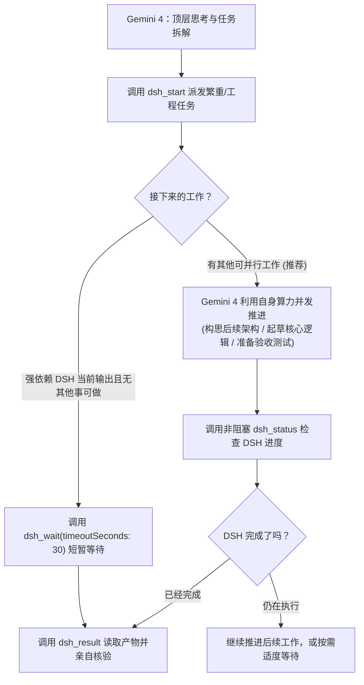

# DeepSeek Flash 协同委托技能指南 (DSH Delegate Guide)

通过 `dsh_*` 工具，Gemini 4 可以调度本地运行的 DeepSeek Harness 实例。

---

## 一、双脑协同定位与分工原则

### 1.1 核心分工准则
- **Gemini 4（大模型主脑 / Tech Lead）**：
  - **顶层设计与深度思考**：剖析任务本质、梳理业务与工程脉络、制定整体大纲；
  - **核心内容创作与业务逻辑**：核心系统逻辑、接口架构设计、关键算法与创意提示词亲自撰写和修改；
  - **调研领航**：先做分析并给出确切方向（指定具体路径、查验节点/文件、技术假设），杜绝让 DSH 盲目全盘扫盘；
  - **成果审查把关**：最终对 diff、生成文件、测试结果进行质量验收。
- **DeepSeek Flash / DSH（执行引擎 / Senior Engineer）**：
  - **繁重工程实现**：多文件代码编写、脚手架搭建、批量格式重构；
  - **自动化测试与工程构建**：多文件修改与重构、自动化测试脚本运行、错误排除与工程构建；
  - **定点代码深潜**：根据 Gemini 给出的明确方向翻阅大文件源码、摸底本地接口并提取事实证据。

---

## 二、异步解耦与并行工作机制（参考 Subagent & Teamwork 设计）

### 2.1 破除旧有阻塞定势
过去最突出的问题是：Gemini 派发任务后，下意识地立刻调用阻塞式 `dsh_wait`。`dsh_wait` 一等数十秒甚至连 call 好几轮，导致 Gemini 自身的大脑停滞，什么别的事情都干不了。

### 2.2 现代异步协同范式：一边等待，一边做事
DSH 会话在本地后台独立运行，`dsh_start` 返回 `sessionId` 后即已进入自主执行状态。

参考 **Antigravity 的 Subagent / Task 机制** 与 **DSH 的智能体团队 (Teamwork) 机制**：
**派发任务后，主控可以选择等待，更可以选择利用这段时间去干别的事情！**

### 2.3 实战长任务并发场景对比

| 任务场景 | 过去的反模式（阻塞死等） | 现在的最佳实践（并行推进 / Overlap） |
|---|---|---|
| **模块重构与测试闭环** | Gemini 派发重构后，连续多次 `dsh_wait` 傻等 DSH 修改与跑测试。 | Gemini 负责设计接口规范与核心算法，将实现与跑测试交给 DSH。DSH 运行期间，Gemini 并发梳理后续业务模块或编写验收测试用例，双线推进。 |
| **通识课作业/评测** （参考 [AI 通识课作业代写](conversation://84f7e37a-2863-4d15-8d22-b0fee6234d76)） | Gemini 把实测与论文全部甩给 DSH，并在 wait 循环中空转。 | DSH 后台跑真实模型测试；Gemini 前台立即撰写不需要测试数据的哲学论辩部分（如人机边界思考），充分利用等待时间。 |
| **LoRA/局部重绘调研** （参考 [LoRA Image Generation Task](conversation://a01a9091-cbc8-4156-b77b-07de519f8b06)） | 启动 subagent 盲目漫游，没有明确的技术假设与排查边界。 | Gemini 先分析技术难点，圈定具体的 ComfyUI 节点与路径让 DSH 定点检索；检索期间，Gemini 并发构思重绘提示词与创意工作流。 |

---

## 三、科学使用智能体团队 (Teamwork)

DSH 的智能体团队非常强大，**不能盲目封杀，但严禁细碎任务无脑滥用**：

1. **单兵执行模式（明确任务首选）**：
   - 目标明确、路径聚焦的任务（如单模块重构、特定报错修复、接口编写），在 Brief 中注明：`【执行建议】：本任务由当前会话单兵直接调用工具执行即可。`
   - 优势：响应迅速、节省 token 额度、避免多 agent 交叉传递失真。
2. **智能体团队模式（复杂大工程选用）**：
   - 涉及大型全栈项目、跨多个独立子系统的综合调研与架构落地，可放开让 DSH 启用智能体团队协同，发挥其多兵种联合作战能力。

---

## 四、工具调用参考

- `dsh_start(cwd, prompt, title)`: 启动会话，立即返回 `sessionId`。任务已在后台运行，Gemini 可立即开展其他工作。
- `dsh_status(sessionId)`: **非阻塞状态查询**。在并行推进其他任务之间，看一眼 DSH 的最新执行动态与末尾文字。
- `dsh_wait(sessionId, timeoutSeconds: 30)`: 可选的同步等待。仅在手头确实没有其他并行工作、且下一步强依赖该结果时使用。
- `dsh_result(sessionId)`: 读取完成成果（文本、变动文件列表 `filesChanged`、`tokenUsage`）。
- `dsh_send(sessionId, message)`: 复用现有上下文跟进新任务。
- `dsh_cancel(sessionId)`: 终止当前轮次。
- `dsh_list()`: 查询会话列表。
